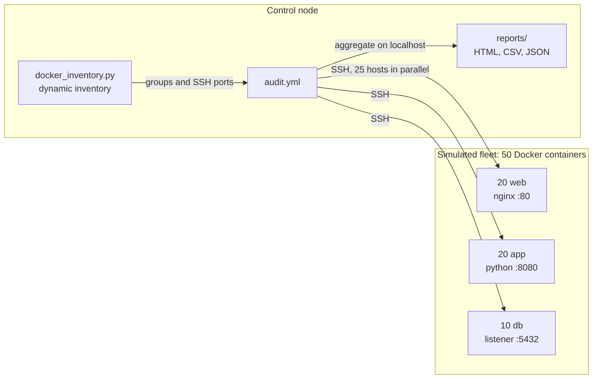
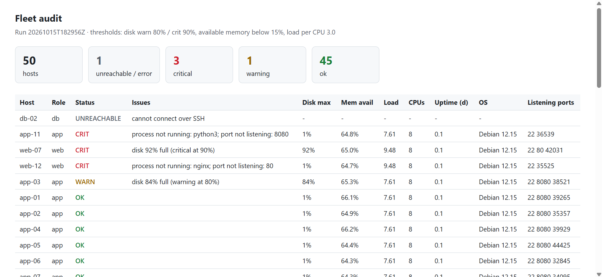

# ansible-fleet-audit

Audit the health of a fleet of servers with one command: disk, memory, load, uptime, OS, running processes and listening ports, checked against thresholds, with a ranked report that puts the worst hosts first.

[](https://github.com/OpeyemiAdeniji/ansible-fleet-audit/actions/workflows/ci.yml)

## What this proves

- Ansible at fleet scale: dynamic inventory, role-based group variables, parallelism (`forks`), connection reuse.
- Failure-tolerant automation: an unreachable host is reported, not fatal.
- Operational thinking: thresholds, per-role expectations, severity ranking, and a [runbook](runbook.md) for what to do about each finding.
- Engineering hygiene: tests, linting, CI, pre-commit hooks, conventional commits and [decision records](docs/adr/).

## Architecture



1. The inventory script asks Docker which containers carry the `fleet.audit` label and groups them by their `fleet.role` label.
2. The first play applies the `audit_host` role to every host in parallel. Each host collects its own numbers, compares them with the thresholds in `playbooks/group_vars/`, and stores one `audit_host_record`.
3. The second play applies the `audit_report` role once on the control node. It gathers every host's record (or notes that none exists) and writes the reports.

## Quick start

Needs Docker, Python 3.10+, `make`, `git` and `ssh-keygen`. On Windows, use WSL2 and keep the repo in the Linux home folder (not under `/mnt/c`).

```bash
python3 -m venv .venv && source .venv/bin/activate    # once per terminal session: source .venv/bin/activate
make setup        # install Ansible, ansible-lint, pre-commit, git hooks
make fleet-up     # build the image, start 50 containers (about 2 GB of RAM)
make ping         # SSH check: you should see one unreachable host (db-02)
make audit        # run the audit
open reports/latest.html     # or xdg-open on Linux
make fleet-down   # tear the fleet down
```

The fleet comes with five deliberate faults, so the first report is not boring:

| Host | Fault | Expected status |
|---|---|---|
| `web-07` | `/data` volume 92% full | CRIT |
| `app-03` | `/data` volume 84% full | WARN |
| `web-12` | nginx not running | CRIT |
| `app-11` | app server not running | CRIT |
| `db-02` | sshd not running | UNREACHABLE |

Edit `INCIDENTS` in `scripts/generate_fleet.py` to build your own scenarios.

## What gets checked

| Check | How | Flagged when |
|---|---|---|
| Disk | `df -P`, every real filesystem (read-only images such as squashfs, iso9660 and erofs are skipped: they are always 100% full) | at or above 80% (warn) or 90% (crit) |
| Memory | `MemAvailable` from `/proc/meminfo` | available below 15% of total (warn) |
| CPU load | 1-minute load average divided by CPU count | at or above 1.0 (warn) |
| Processes | `ps` against the role's `audit_host_expected_processes` | an expected process is missing (crit) |
| Ports | `ss -ltn` against the role's `audit_host_expected_ports` | an expected port is not listening (crit) |
| Also recorded | uptime, OS and version, all listening ports | |

All thresholds and expectations live in [`playbooks/group_vars/`](playbooks/group_vars/) and override the defaults in each role. Change a number, re-run, no code edits.

## Project layout

```text
playbooks/
  audit.yml                    two plays, each one just calls a role
  group_vars/                  thresholds (all.yml) and per-role expectations (web, app, db)
  roles/
    audit_host/                collects and judges one host (runs on every host)
    audit_report/              builds CSV, HTML and JSON from all hosts' records (runs once)
inventory/
  docker_inventory.py          dynamic inventory for the simulated fleet
  examples/                    cloud inventory examples (not exercised in this repo, see below)
```

## Cloud inventories and credentials

The audit roles do not care where hosts come from, only that they are in the `fleet` group with a role group (`web`, `app`, `db`). The simulated fleet uses Docker. For real clouds, [`inventory/examples/`](inventory/examples/) holds example inventory files for AWS (`aws_ec2`), Azure (`azure_rm`) and GCP (`gcp_compute`).

**These examples have not been run in this repository.** They document the intended design: Ansible gets short-lived credentials from an assumed role or workload identity, never a stored access key. The reasoning is in [ADR 0004](docs/adr/0004-no-long-lived-cloud-credentials.md). Real runs are planned for AWS first, then Azure and GCP.

## Reports

`reports/latest.html` is the one to open. `latest.csv` is for spreadsheets and `latest.json` is for other tools. Every run also keeps a timestamped copy. Reading a report and acting on it is covered in the [runbook](runbook.md).



## Cost estimate and teardown

Free: everything runs locally in Docker. Expect about 2 GB of RAM while the fleet is up and a few hundred MB of disk for the image.

```bash
make fleet-down   # stop and remove all containers
make clean        # delete generated reports
```

## Known limits

- **The fleet is simulated.** Containers share the host kernel, so memory, load, CPU count and root disk figures are the host's, not per-container values. Disk variety comes from a small `/data` volume per container. Pointed at real servers, every number is genuinely per host.
- **No systemd in containers**, so services are checked by process name and listening port instead of `service_facts`. On real VMs you would add a `service_facts` check.
- **Host key checking is off** (`ansible.cfg`) because containers get new keys on every rebuild. Never do this against real servers.
- **The SSH key is baked into the image.** Fine for a throwaway simulation, wrong for anything real.
- **Read-only image filesystems are skipped** (`squashfs`, `iso9660`, `erofs`). They are always 100% full by design, so they would raise a false CRIT (snap packages on Ubuntu, Docker Desktop tools on WSL2).
- Not tested on Windows. Use WSL2.

## Design decisions

See [`docs/adr/`](docs/adr/):

- [0001](docs/adr/0001-simulate-the-fleet-with-containers.md): simulate the fleet with containers
- [0002](docs/adr/0002-dynamic-inventory-script.md): a dynamic inventory script instead of a static file
- [0003](docs/adr/0003-collect-then-aggregate.md): collect on each host, aggregate on the control node
- [0004](docs/adr/0004-no-long-lived-cloud-credentials.md): no long-lived cloud credentials; roles and workload identity

## Contributing

See [CONTRIBUTING.md](CONTRIBUTING.md).

## License

[MIT](LICENSE)
